# Development record - 2026-10-14

Branch: `feat/architectural-command-gameplay`

Starting revision: `65ac7c4` (second floor and cross-floor incident)

## Result

The existing two-floor prototype now has a playable mission and operations layer.
Cloud and AI cards perform bounded game actions instead of showing future-feature copy.
The current interface is a dark command workspace with official individual product
marks and the Solvia panda. See the dated follow-up below for the latest gameplay and
visual changes; earlier daylight screenshots are retained as development history.
Realistic models remain pending; procedural staff and furniture are temporary.

## Gameplay

| Assignment | Pressure | Decisions |
| --- | --- | --- |
| The Quiet Morning | Discreet intrusion across both floors | Place sensors, correlate with XDR, isolate the correct endpoint |
| The Lockout | Stolen remote identity and two encryption targets | Scope remote access, prepare snapshots, restore separate rooms |
| Under Pressure | Application traffic, host failure and intrusion | Reserve capacity, distribute load, retain detection and response budget |

Guided starts with 22 credits, stretches event timing by 1.2 and applies 0.8 disruption
damage. Standard uses 15 credits and baseline timing/damage. Expert starts with 12,
uses 0.8 timing and 1.15 disruption damage. These values are game tuning, not product metrics.

Operational preparation is available only during setup:

- **HCI (4):** reduces host-failure impact and the ongoing downtime of encrypted rooms.
- **ADC (3):** reduces the scripted application traffic surge; it is not unlimited DDoS protection.
- **SASE (4):** rejects the unauthorized remote session; the actor uses a slower local route.
- **AICP + Agent Builder (3):** runs an authored local rule. Notify needs XDR correlation;
  recovery needs aStor snapshots prepared before the incident. No external AI is called.

aStor remains in Defense. Buying it during an incident does not prepare snapshots.
EDR only observes/protects its specific endpoint. Detection and containment remain separate.

## Correctness and interaction changes

- Reject invalid endpoints, duplicate preparations and unavailable-phase actions without spending credits.
- Isolating another device in the same room no longer contains the actor.
- Preserve encryption after containment; let the operator recover already affected rooms.
- Distinguish contained-but-unrecovered services from a clean containment outcome.
- Record unauthorized remote sessions even when SASE is absent.
- Retain event truth in the log, including repeated ransomware events.
- Replay executed attacks only, including the first beat; switch floors as the replay crosses levels.
- Hide inactive-floor pick targets and effects. Correct lower-floor scan, veil, lock and cage heights.
- Place network sensor effects on both floors and hide the inactive set.
- Dispose stage resources on restart and dispose expired pulses, trails and correlation objects.
- Cancel camera focus tweens when the player begins an orbit interaction.
- Separate navigation positions from animation offsets to prevent walking-character height drift.
- Accelerate replay routes to the review cadence and wait for each route to finish before advancing.
- Restore visible room-placement highlights and expose endpoint IDs in the inspector.
- Skip unchanged HUD, feed and deck markup; preserve focus and deck scroll position when
  changes are needed. This fixes live buttons being detached while an operator clicks them.
- Keep English/Chinese switching available throughout selection, setup, play and review.
- Add keyboard pause, floor switching, overview and placement cancellation.
- Add opt-in, locally synthesized ventilation/hum. Playback starts muted.
- Export `sentinel-session.json`, containing English event truth and actual deployment/response history.
- Fix the development server's direct entry point on Windows and support ephemeral test ports.

## Presentation

- Daylight, neutral city context, warm key light and readable natural materials.
- Light panels, quieter green accents, consistent spacing and visible focus outlines.
- Assignment cards with clear resource and timing information.
- Playable infrastructure cards, helper dependency indicators and a response checklist.
- Close view and overview controls, plus floor-aware inspection.
- Storage cabinets replace the rotating gold polyhedron in the Data Room.
- Official Sangfor logo image variants remain unchanged; no branding is generated into meshes.
- Added contextual debrief, report export and a facilitator guide.

## Validation

Final local run: **`npm test` passed on Windows, 2026-10-14**. All nine engine
regression groups passed. The original smoke produced delayed survival for the strong
loadout (8 detected / 9 executed attacks), collapse without defenses, and containment
for precise endpoint isolation. The complete UI suite passed, including mobile live
pause controls and a regression against walking-character height drift. No page/console
errors or external HTTP requests were reported by the UI suite.

`npm test` runs three layers:

1. `tools/engine.test.mjs`: nine deterministic regression groups covering all nine
   mission/difficulty combinations, endpoint precision, invalid actions, infrastructure
   effects, remote policy, snapshots, helper dependencies, post-containment recovery,
   and simulation step ordering.
2. `tools/smoke.mjs`: original strong-loadout, undefended and targeted-containment scenarios,
   WebGL startup, runtime errors and screenshots.
3. `tools/ui.test.mjs`: actual mission/difficulty selection and language controls,
   operational preparation, helper rule selection, canvas deployment on both floors,
   keyboard pause, automatic recovery, debrief/report export, executed-event replay,
   mobile selection layout and absence of external HTTP dependencies.

Screenshots are generated under ignored `tools/shots/`. Selected English review captures
are included in `docs/screenshots/`. Visual review of the browser render is required
in addition to engine tests.

GitHub Actions runs the same test command for pull requests and the development/main
branches, and retains browser screenshots as a short-lived workflow artifact.

### Review captures

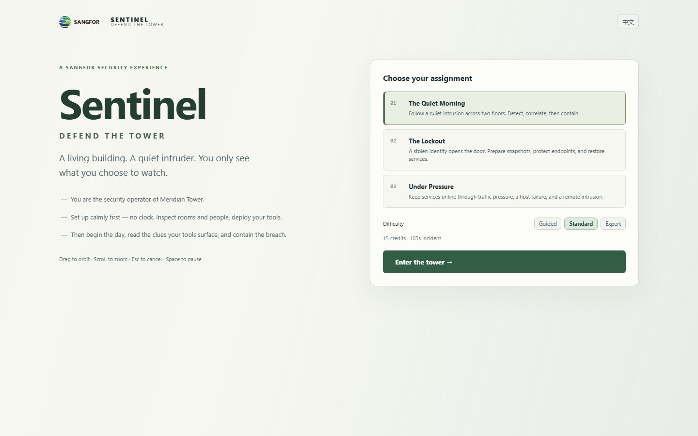

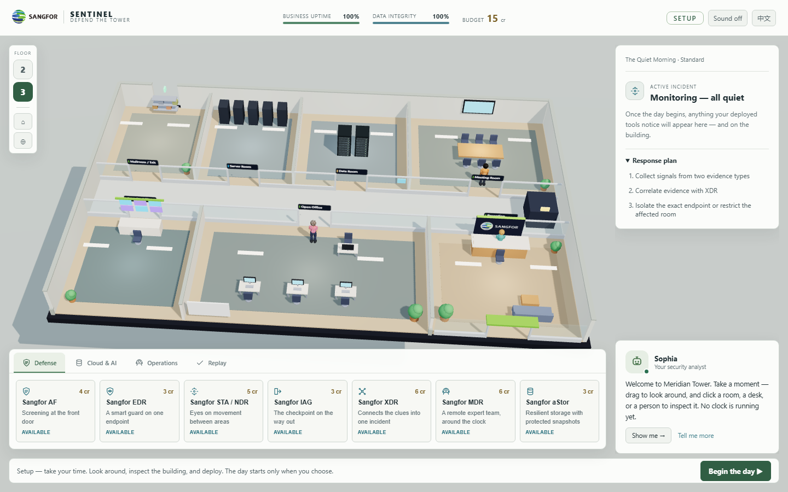

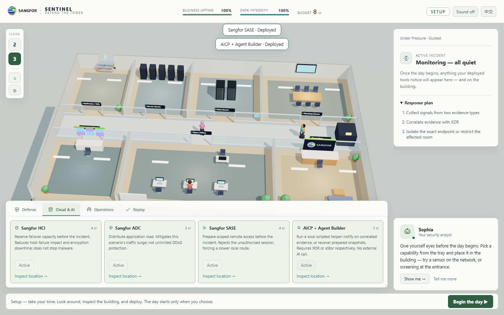

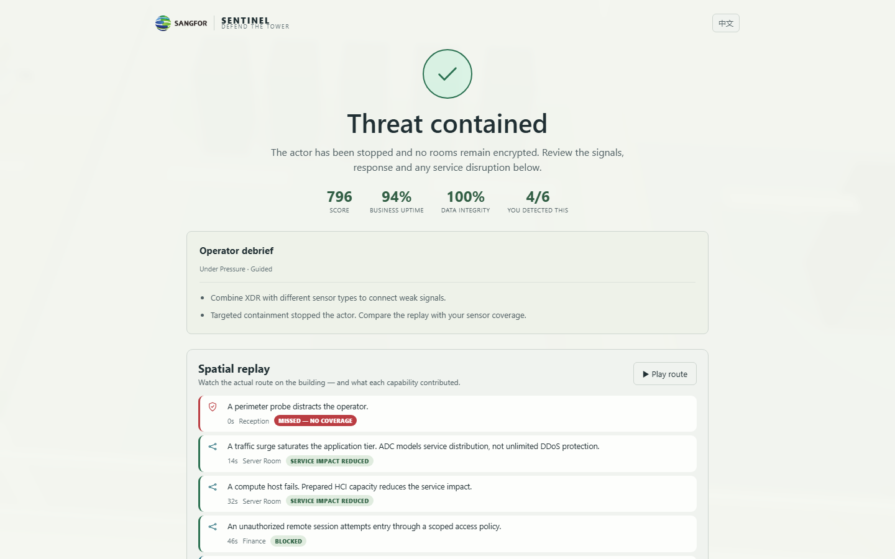

## Remaining limitations

- This is a complete playable prototype expansion, not a completed realistic-art release.
- Current office figures, furniture and distant city geometry are procedural stand-ins.
- The GLB character path is disabled. Its old CesiumMan-specific scale and single-animation
  assumptions must be replaced before adopting production office characters.
- No external model-service assets have been approved or added to the runtime in this iteration.
- Missions retain authored schedules. SASE now selects a different foothold route; this is
  one bounded decision branch, not a general adversary system or a branching campaign.
- Recovery now takes 6 seconds (4 with HCI) and 2 credits. There is no backup server,
  production security integration or live LLM service.
- Desktop rendering and mobile selection/layout have automated coverage; a human touch-device
  and event-hardware play-test is still needed for visual and difficulty acceptance.
- No service worker or installable offline package is included. A local static server works
  without external runtime HTTP requests after the repository is available locally.

See [the continuation prompt](CLAUDE_HANDOFF.md) for the next implementation pass.

## Command interface and gameplay depth — 2026-10-14 follow-up

### Presentation and brand identity

Replaced the light workspace skin with a reference-led command interface. The new layout
uses a dark navy HUD, cyan sensor indicators, teal/green readiness states, red response
controls, a right incident/inspection column, full-width product cards and a compact ticker.
The actual 3D building remains interactive; no flat reference image replaces the scene.
Room placards face the camera and hide in close views. Mobile keeps a horizontally
scrollable product deck and accessible pause/language/floor controls.

Added unmodified official Sangfor Athena and Sangfor Cloud lockups from the official logo
PPT kit, and enlarged the existing corporate logo. Cards show portfolio product names
rather than only metaphors. The assistant is now **Solvia**, using the official community's
panda image. The temporary reference-derived human portrait was removed before publication.
Solvia's hint behavior is still local game logic; its visible footer states this clearly.
Original room/action/evidence pictograms remain functional UI artwork. All 11 product
cards now use independently sourced official product symbols instead of original SVGs;
the inspector coverage badges share the same mapping. Ten images are unchanged official
community downloads; MDR preserves the complete shield from an official solution diagram.
The source inventory records legacy/current product associations and extraction details.
Source URLs are recorded in `assets/brand/ASSETS.md`.

Improved procedural surfaces with deterministic local tile/carpet/wood textures, glass
mullions, warm perimeter lighting, rack faceplates/LEDs, desk accessories, muted business
clothing and instanced foliage. This improves readability and coherence but does not
complete realistic characters, furniture, animation, reflections or production art.

### Rules and operator choices

- Setup purchases enter a mixed product/infrastructure history. Undo removes the latest
  purchase and refunds its full cost. Reset repeats undo. Both are rejected after start.
  Visible props, endpoint screen state, coverage and snapshot readiness follow the refund.
- SASE rejects a remote session and delays the schedule by 12 simulation seconds. The next
  foothold switches from `l2-finance#1` to `office#2`, with new bilingual event truth.
  Evidence uses the actual endpoint's coverage; branch choice is logged in the JSON report.
  Only per-session beat copies change. Other missions and source templates stay immutable.
- Snapshot restore requires setup-prepared aStor, 2 credits and an exclusive restore slot.
  It takes 6 simulation seconds, or 4 with HCI. Existing encryption keeps costing uptime
  until completion; pause freezes the job. The inspector shows progress and cancellation.
- Cancel returns 1 credit; the other credit is the spent setup effort. A cancelled helper
  restore stays suppressed until a manual restart, preventing repeated automatic spending.
- The helper schedules one affordable restore at a time. Containment preserves encryption
  and keeps the incident playable until recovery completes or the deadline is reached.
- Objectives distinguish containment and data preservation plus the mission's restoration
  or uptime target (Quiet Morning 70%, Under Pressure 80%). Reports include objective state;
  debrief guidance explains alternate endpoint coverage and response-resource planning.

### Verification

The engine suite now contains 13 regression groups, including mixed refunds, immutable
route branching, restore duration/cost/cancellation, helper cancellation and objective rules.
The real-browser suite covers Solvia/official logo asset loading, actual undo/reset buttons,
both-floor canvas deployment, EN/ZH, timed helper recovery, reports, replay and mobile HUD.
Browser suites run sequentially to avoid software-WebGL resource contention.

### Next work

Human play-testing, further response-driven branches, persistence/accessibility review,
and production office models/animation remain open. Asset-service automation is deferred.

### Individual product mark correction

The initial portfolio-logo pass did not replace the individual card SVGs. Corrected
that path explicitly: AF/NGFW, EDR/EPP, STA/NDR, IAG/SWG, XDR, MDR, aStor, HCI,
ADC, SASE and AICP now use official image files. `productMark()` is shared by both
card decks and inspector coverage badges. Artwork retains color/aspect ratio, uses
neutral plates for legibility, loads from the local server and survives EN/ZH switching.
AICP uses the official AI platform symbol; no separate Agent Builder mark is claimed.

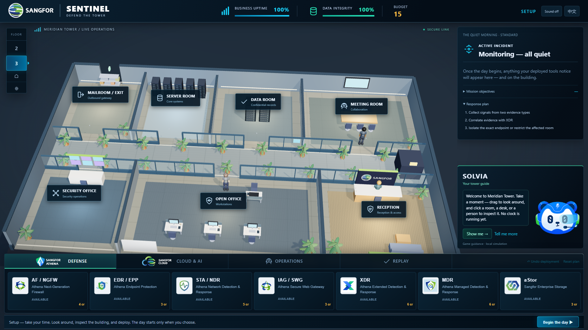

### Final local validation and review status

`npm test` passed after the product-mark integration: 13 engine regression groups,
three browser smoke outcomes (strong defense: delayed; no defense: collapse; exact
isolation: contained), and the full UI suite. UI checks include all seven defense
images and all four infrastructure images loading, Solvia, EN/ZH, undo/reset,
two-floor canvas deployment, timed recovery, reports, replay and mobile controls.
No external runtime requests or browser errors were reported. `git diff --check` passed.

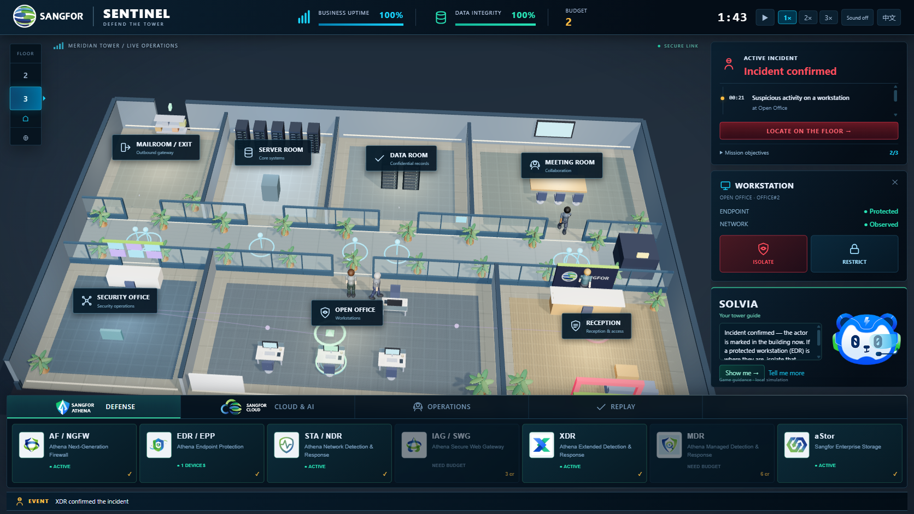

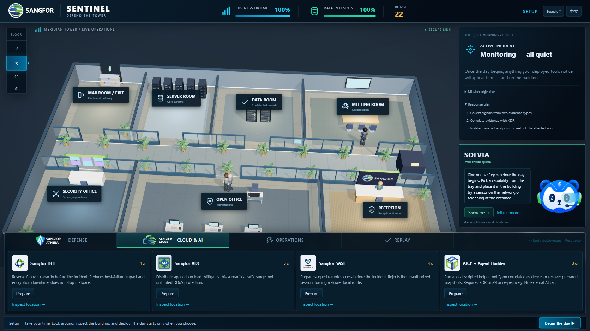

> Status note: this section's branch/Pages statements were accurate when written. The feature
> work was since merged (PR #1 → `main`, merge commit `38d33b0`) and published to GitHub Pages.
> See the 2026-10-14 "Performance + gameplay release pass" below for the released state and the
> live-site verification. Local preview: `npm run serve`.

## Gameplay-polish pass — 2026-10-13

Continued from `c871244`. The command interface, missions, operations, recovery loop and
honest outcomes were already implemented and tested; this pass audited the whole loop against
that UI, preserved it, and fixed the real gaps it surfaced rather than rebuilding anything.

### Audit (played, not just read)

Drove the engine directly through every assignment × difficulty with budget-correct strategies
and an informed-player response policy (deploy, read the visible endpoint clue, isolate the exact
foothold device; mitigate scripted infrastructure events). Findings:

- **All nine combinations are winnable within budget**, with meaningful tradeoffs. The backbone is
  cheap: EDR on the foothold device + isolate on the endpoint clue contains early and prevents the
  later ransomware/exfil beats. Richer sensors (NDR building-wide visibility + XDR correlation,
  MDR assist) are the premium detection path, not a requirement to win.
- Expert (12 credits) is tight but viable — e.g. Quiet Morning with AF + one EDR; Under Pressure
  with ADC + HCI + one EDR; The Lockout by containing the Finance foothold before it pivots.
- **Undefended play loses** (collapse/breach) in every mission — poor preparation has clear,
  understandable consequences.
- Exact-endpoint isolation (wrong device in the same room does not contain), the SASE
  alternate-endpoint branch (remote denied → foothold `office#2`, evidence follows the real
  device, branch logged), the recovery loop and honest partial outcomes all behave correctly.

No engine defects were found; the mechanics are sound. Two gaps were real and are fixed below.

### Fixes

- **Brand correctness.** The in-world placement highlight for slot products (AF/IAG/XDR/aStor)
  still glowed legacy threat-red (`0xE60027`) on the room you were about to *protect*. Valid
  deploy targets now glow brand-green (`0x39e08a`, matching EDR); red stays reserved for threats.
  Corrected the stale "brand red is a placeholder" note at the top of `main.css`
  (the brand is green/blue, per `assets/brand/ASSETS.md`).
- **Truthful planning feedback.** Infrastructure operations that the current assignment's
  *player-visible briefing* will not exercise (e.g. ADC and SASE in The Quiet Morning, which has
  no traffic-surge or remote-session beat) were silently buyable no-ops. They now carry a
  "Defense-in-depth — this assignment's briefing does not call on it" note in the Cloud & AI deck,
  so credits are spent knowingly. Relevance is derived from the mission beats only
  (`ddos`→ADC, `remote`→SASE, `failure`/`locks`→HCI, AICP always) — never from hidden attack
  truth, and the briefings already telegraph the threat shape. Display-only; templates unchanged.

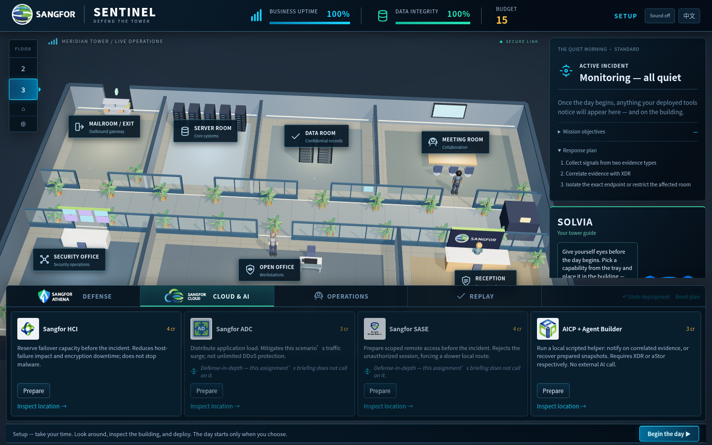

### Tests

- Added two engine regression groups (suite now 15): *every mission/difficulty has a demonstrated
  viable winning strategy* (plays each combo to a `win` verdict within budget) and *infrastructure
  operations match the exercising events of each assignment*.
- Made the Playwright click helper robust to software-WebGL by skipping the spurious post-click
  navigation wait (these controls never navigate). This removes a software-rendering stall without
  weakening any assertion; hardware-GL behaviour is unchanged.

### Validation

`npm test` — engine (15 groups), smoke (strong→delayed, none→collapse, isolate→contained) and the
full Playwright UI suite. Visual review (1440×900) of the command UI, both floors, the Cloud-deck
relevance notes in EN and ZH, the brand-green placement highlight and the review/replay screens;
no console errors or external runtime requests.

Backend-independent scene cost was measured (draw calls / triangles / lights / shadow maps) to
track the detail-pass regression noted earlier; see the measurement note below. Frame-time/FPS was
**not** measured here because this environment only has software WebGL (SwiftShader), which the
handoff correctly says is not representative of GPU hardware.

### Scene-cost measurement (backend-independent)

Measured with `renderer.info` after one render, 1440×900, setup phase, The Quiet Morning,
software WebGL (SwiftShader). These counts (draw calls, triangles, geometries, lights, shadow
maps) are GPU-backend-independent; frame time is not, so FPS is deliberately not reported here.

| Scene state | Draw calls | Triangles | Geometries | Lights (scene) | Shadow maps |
| --- | --- | --- | --- | --- | --- |
| Level 3 active (setup) | 1,112 | 132,618 | 651 | 19 | 1 |
| Level 2 active (setup) | 1,105 | 114,126 | 1,274 | 19 | 1 |

The counts are higher than the handoff's fixed-camera sample (≈663 calls / 67.6k tris): this
sample uses the live mission camera (which frames more of the floor) and includes animated staff
and the effects layer. They confirm the detail-pass cost the handoff flagged (separate rack
panels/LEDs/handles, desk accessories, glass mullions). The clear next lever is **merging static
per-room detail into shared geometry/materials** (`BufferGeometryUtils` is already vendored) and
reducing the active light count, which cuts draw calls without changing the visual direction.

That refactor is intentionally **not** done in this pass: it touches `src/world/building.js` and
would need re-verification of the picking, coverage and floor-visibility invariants the handoff
calls out, and — more importantly — a draw-call/frame-time improvement can only be validated on
**hardware-accelerated GL**, which this environment does not provide. It is queued as a dedicated,
separately-measured performance pass (before/after on an Iris-Xe-class browser), per the handoff.

## Performance + gameplay release pass — 2026-10-14

This pass implemented the deferred performance optimization and substantive gameplay depth,
then merged and published the reviewed feature work.

### Performance: static geometry batching

The detail pass had turned every rack panel/LED/handle, desk leg, drawer, mullion, chair and
plant pot into its own mesh (~666 meshes per floor). `src/world/building.js` now:

- **Caches identical static materials** (keyed by colour + serializable options), so repeated
  detail shares one material. Textured materials (floors/rugs) are intentionally not cached.
- **Merges static, opaque, non-interactive meshes per level** into one mesh per
  (material, shadow-flags) bucket, via `mergeGeometries` (already vendored). Geometry is baked
  into level-local space, so stacked floors stay correct.
- **Keeps pickables and runtime-mutated meshes separate** with their own (cloned) materials:
  room pads, desk tops, `server#core` / `vault#core` cores and the desk screens the EDR deploy
  tints. Picking, placement highlighting and the guarded-screen tint are all still per-object.

Measured (backend-independent `renderer.info`, 1440×900, DPR 1, **fixed camera** `(1.5,32,28)`→
`(-0.5,0,-2.2)`, SwiftShader; FPS not representative and not claimed):

| Scene state | Draw calls before | Draw calls after | Triangles (unchanged) |
| --- | --- | --- | --- |
| L3 setup | 1,112 | **343** | 132,618 → 132,630 |
| L2 setup | 1,106 | **295** | 114,138 |
| L3 active incident (t≈40) | 1,163 | **394** | ~153,440 |

Draw calls fall ~69% at setup, beating the ~400–450 target; triangle counts are unchanged
(same geometry, just batched). Both floors were screenshotted before/after and are pixel-identical,
and the pick API still resolves `office#2` and the server room pad. Lights (≈7 room + globals per
visible floor) and the single 2048² shadow map are unchanged; the hidden floor is already excluded
by Three.js visibility culling. Hardware-GL FPS could not be measured in this environment.

### Gameplay depth

- **Room restriction is now a real decision with consequences.** Locking down the room the actor
  is in still contains them. Restricting an area **ahead** of the actor sets an access-control
  checkpoint that slows them the first time they pass through (adds 12s to the schedule, consumed
  once), at a 6% uptime cost — distinct from prevention and containment. The delay can push an
  exfil past the deadline (a `delayed` outcome instead of a breach). Restricting an off-path area
  is a wasted disruption. Authoritative in the engine; shown in the inspector, ticker and Sophia.
- **Discoverability at the point of action.** Buying a capability you already have, or an EDR on an
  already-protected endpoint, now explains why (`resp.alreadyDeployed` / `resp.alreadyProtected`)
  instead of failing silently. (Insufficient budget and missing prerequisites already did.)
- **Session-specific debrief.** Recommendations are derived from the actual outcome and actions —
  late/weak correlation, the SASE branch, restriction use, breach, delayed, collapse and
  unfinished recovery each produce concrete next-attempt advice (EN/ZH).
- **Keyboard access.** `[` / `]` cycle room inspection on the active floor; Enter begins the day in
  setup; Escape also clears the current inspection. Floor/pause/cancel keys unchanged.

### Validation

`npm test` green — **engine (18 groups)**, smoke (strong→delayed, none→collapse, isolate→contained)
and the full Playwright UI suite. New engine regressions: restriction-delays-without-containing
(and single-consumption), in-room lockdown still contains + restrict-once, and duplicate-deploy
feedback. Nine mission/difficulty combinations remain winnable within budget. Visual review of both
floors (post-batching, identical), EN/ZH new feedback, and a full play-through to review/replay.

Scope preserved: stable endpoint IDs, immutable mission templates, exact-endpoint isolation,
detection/correlation/containment/exit-block/recovery distinctions, the recovery contract
(prepared aStor, 2 credits, exclusive slot, 6s/4s, cancellation refund + suppression), mixed
setup undo/reset, and EN/ZH throughout. Official product marks, Solvia and the dark command UI
are unchanged. Realistic office models/animation remain a separate, deferred brief.

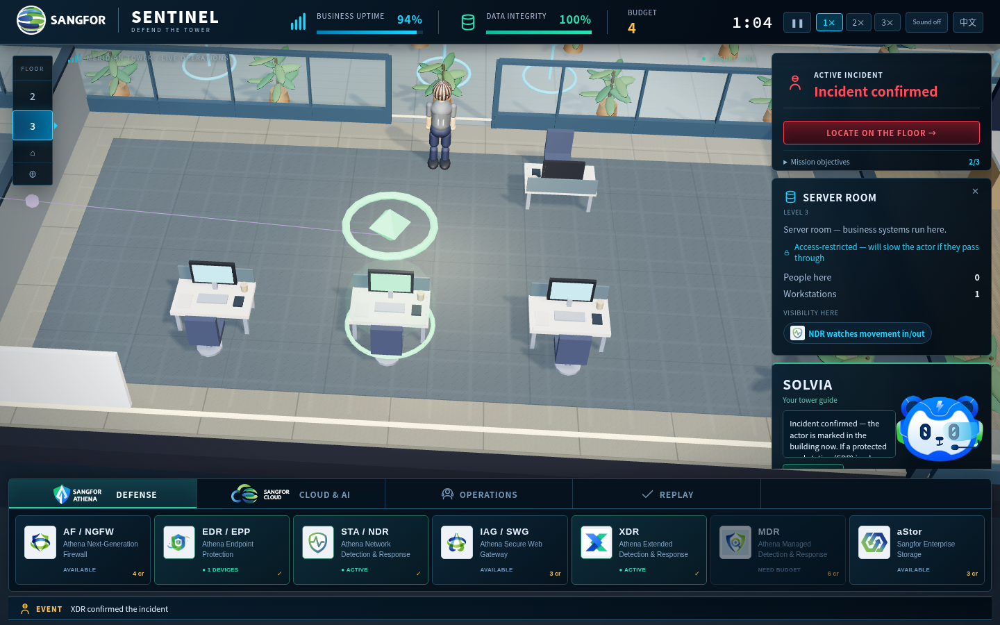

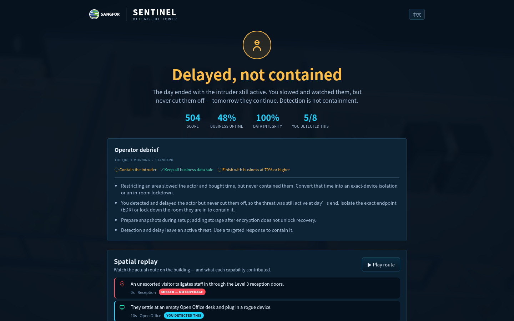

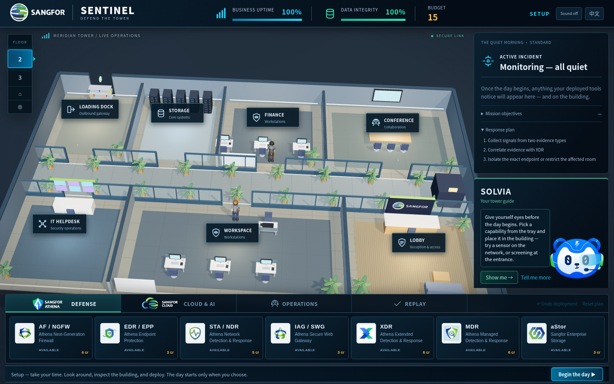

### Released & verified

PR #1 was merged into `main` (merge commit `38d33b0`) after both CI runs on `ea665a8`
(`pull_request` and `push`) passed, and published to GitHub Pages (build of `38d33b0`, legacy
branch source). Verified in a fresh browser context against
https://tru3tz0ne.github.io/sentinel-defend-the-tower/ : the deployed source carries this
release's code (the room-restriction hint and the `mergeLevelStatics` batching — not the prior
`65ac7c4`), the command UI and all 11 official product marks plus the Solvia panda load, both
floors render with static batches present, a mission starts, EN/ZH switches, and there were no
console errors or external runtime requests.

Remaining limitations (unchanged): realistic production office models/animation are a separate,
deferred brief — current figures/furniture are procedural placeholders; exact Sangfor hex/Pantone
awaits brand-guideline confirmation; hardware-GL frame-time was not measurable in this
environment (software WebGL is not representative), so only backend-independent scene counts are
reported. A human acceptance play-test on event hardware remains recommended.

