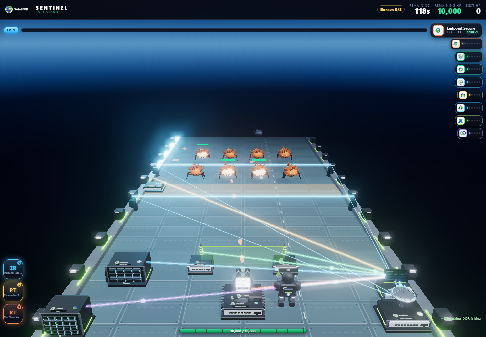
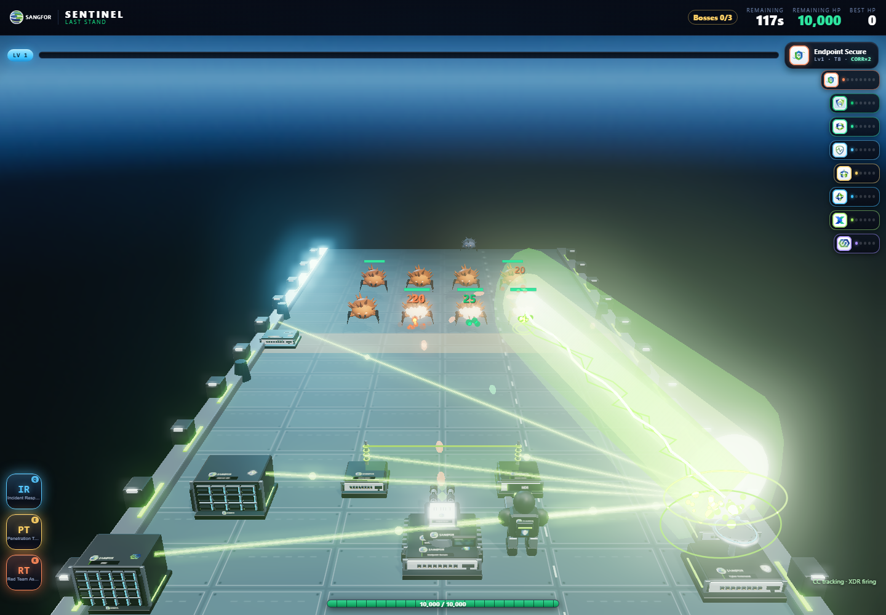
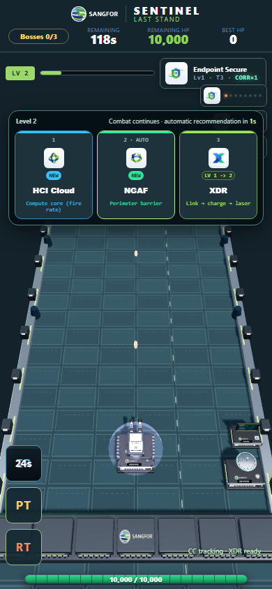
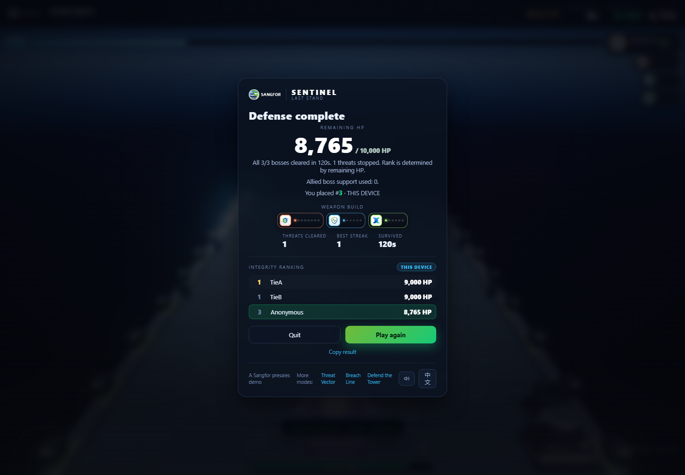

# Last Stand: command network and three-boss event campaign

> Historical release. The enterprise balance update supersedes the assistance,
> tracking and scoring contracts below. See [current record](STAND_ENTERPRISE_BALANCE.md).

Review tag: `stand-command-finale-v1`.
Base: `963e3d7` (`stand-performance-v1`). Branch: `feat/stand-command-finale`.

This campaign replaces the previous endless/pressure-driven pacing in both
`stand.html` (cinematic stage) and `stand-sangfor.html` (equipment preview).
The same combat engine, original equipment models and bilingual interface serve
both entries. No new runtime dependencies, external services or assets are required.

## Playable behavior

### Cyber Command

- NDR is the existing Cyber Command product ID; a second CC upgrade is not added.
- Four side emitters create two horizontal laser strips at 34% and 55% of field
  height. Each strip damages enemies within its actual width while active.
  Control links run from Cyber Command to the side emitters during firing.
- Deploying Cyber Command enables smooth projectile tracking for the operator,
  EDR turrets, MDR and temporary support teams. Projectiles retain their speed,
  retarget dead/already-pierced enemies, and expire after 2.4 seconds so homing
  cannot accumulate permanently orbiting rounds. Collisions still cause damage.
- Every Cyber Command level also adds 10% MDR damage, alongside the existing
  reveal/mark effect. The card/codex describes these as fictional arcade mechanics,
  separate from the real product capability descriptions.

### XDR

- Every deployed product has a connection from its actual battlefield location
  into the XDR appliance. Multiple EDR turrets and both NGAF posts connect separately.
- Colored packets travel from those devices toward XDR for a 0.65-second charge.
  XDR then emits the final targeted laser from its own appliance. Links remain
  visible during firing; they do not themselves inflict damage.
- Sensors and connected product types strengthen the main laser. Existing
  correlation chains now require an actual XDR deployment as well as two sensors.
- Beam rendering and hit testing follow the same angled segment, replacing the
  former vertical-only overlay/collision assumption. One small status line shows
  CC tracking and XDR's current ready/linking/firing state.

### Two-minute completion and HP ranking

- Every player starts with **10,000 HP** and EDR, Cyber Command and XDR at level 1.
- Exactly three bosses enter: ransomware at **25s**, botnet at **60s**, siege at
  **95s**. There is no fourth boss or repeating rotation. Their attacks damage
  the base every four seconds while they remain alive.
- Allied support visibly attacks any boss still alive after 12 seconds, removing
  one eighth of its maximum HP per second. It guarantees a real kill within
  approximately 20 seconds of entry even without player fire. Death, not an escape,
  timer expiry or despawn, increments the boss-clear counter.
- Emergency cover preserves the final **1 HP**, with an explicit notification and
  result disclosure. This is intentionally accessible event play. Completion is
  not a claim that the player independently defeated every boss.
- The mission completes at **120 active seconds** after all three real deaths.
  Regular waves stop after 114 seconds. Upgrades do not pause play: choose with
  a click/tap or 1/2/3; after three seconds the marked recommendation deploys.
  Q/E/R remain usable during an offer. Explicit pause freezes combat and offers.
- Remaining integer HP is the only ranking score; equal HP has equal rank.
  Recovery and support can restore HP up to 10,000. Kill counts, levels, boss aid
  and product count are information, not hidden ranking tie breakers.
- Local leaderboard: `sentinel.stand.health.scores.v1`. Best:
  `sentinel.stand.health.best.v1`. Historical kill-score records remain untouched.
  A separate, optional `window.__STAND_HEALTH_API` can enable a shared board; it
  must use a separate backend namespace from the old `__STAND_API`. Without that
  configuration, ranking is explicitly local to the current browser, suitable
  for a shared event station. Separate computers do not automatically share it.
- Delayed ranking responses cannot replace a replay with an earlier result.

## Quality and performance

Native DPR up to 2, existing antialiasing, models, lighting, 2048-pixel cinematic
shadows, bloom, particles, damage text and original effects remain enabled.
Projectiles and enemy parts retain the instancing optimization. The new thin
links/strips/packets share four instanced draws instead of one mesh per connection.
The population stays bounded at 64; ordinary spawns/minions/splits reserve three
slots for scheduled bosses. No simulated projectile or threat is dropped by the
renderer to meet a budget.

The fixed 1440×1000 pressure fixture includes maximum product upgrades, both
support teams, **64 enemies, 256 bullets, active CC strips, all-device XDR links
and the final XDR laser**. It measures **415 complete-frame draws**, including
shadows and postprocessing, and **118 geometries**. Bullets still use one draw.
The previous performance fixture without these active new effects measured 403
draws / 111 geometries; these are different effect loads, not an FPS comparison.
The native-DPR-2 check still reports a drawing-buffer/client-width ratio of 2.

No hardware FPS claim is made. Software WebGL counters verify rendering/resource
costs; target event PCs still need a brief smoothness and human usability check.
120 seconds is active simulation time, not a guaranteed stopwatch measurement on
a stalled/background tab. Upgrade choices no longer extend it and boss impact
effects no longer slow its simulation clock. Slower rendered frames use small
physics substeps with up to 0.25 seconds of catch-up per frame, preventing the
old 50ms frame clamp from stretching normal low-FPS sessions.

## Verification

- Existing rules: `node --test tools/engine.test.mjs tools/rush-logic.test.mjs tools/arcade-logic.test.mjs` — 65 pass.
- Campaign: `npm run test:stand-balance` — 13 regression groups, including 72
  seeded desktop/phone runs using the production combat closure. All finish at
  120 seconds with three boss deaths and legal HP. A separate no-fire fixture
  verifies real allied damage and all three assisted deaths.
- Browser: `node tools/stand-art.test.mjs` covers EN/ZH instructions, real
  XP/upgrade deployment, nonblocking offers and skills, auto recommendation,
  every product and threat silhouette, paused state, bounded rebuild resources,
  mobile fit, actual CC/XDR transitions, final-kill/result/replay callbacks,
  old-score isolation, equal-rank display and the existing 3D showroom.
- Rendering: `npm run test:stand-performance` checks the expanded pressure
  fixture, single bullet draw, wave reuse, visible cloak changes, resource
  stability, capacity growth to 513 bullets, restart and native high DPI.

The seeded policies are regression strategies, not a representative human study.
Their mean remaining HP is:

| Device | Idle / automatic upgrades | Casual | Informed |
| --- | ---: | ---: | ---: |
| Desktop | 9,146 | 9,565 | 9,854 |
| Phone | 9,137 | 9,452 | 9,879 |

Generated JSON and raw screenshots live under ignored `tools/shots/`. The
review images below deliberately use fixtures to expose effects and transitions;
they are not natural progression or human playthrough evidence.

## Publication

Publish the feature branch and review tag, then fast-forward `main` only after
fetching and preserving any concurrent changes. GitHub Pages follows `main`;
the tag alone does not deploy the game. Verify the versioned entry and production
campaign behavior after Pages publishes. The English continuation brief is
`docs/CLAUDE_STAND_VISUALS_HANDOFF.txt`.
