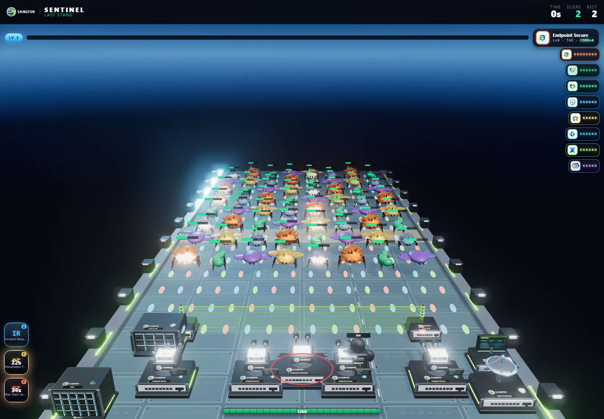

# Last Stand: preserve visual quality, reduce late-game rendering cost

The instancing work below remains in use. Current campaign/effect behavior and
its expanded 415-draw pressure fixture are documented in
[STAND_COMMAND_CAMPAIGN.md](STAND_COMMAND_CAMPAIGN.md); the unchanged-combat and
403-draw statements below refer to this historical performance tag.

Review tag: `stand-performance-v1`. Baseline: `180c52c` (short-session balance).

Late-game projectile counts previously created one geometry, material and draw
per bullet. Repeated threats shared their template geometry but created and
disposed complete mesh/material hierarchies as individual enemies arrived and
died. At high density, scene and shadow draws became expensive even though the
game already limited active threats to 64.

## Implementation

- Projectiles use one instanced sphere mesh with the original geometry, additive
  material, per-projectile colors, scale and position. Capacity grows by powers
  of two, reuses its geometry/material, and disposes obsolete instance buffers.
  No projectile is dropped or omitted from simulation or rendering.
- Threats batch by type, cloak state and hit state, using their original material
  groups. Every creature retains its geometry, individual transform, motion,
  emissive hit flash, cloaking, and cast/receive-shadow settings. Batches survive
  removal, new waves and restarts. Only small matrices are updated each frame.
- Instance buffers/materials have explicit ownership and cleanup before template
  geometry is released. Unit/equipment construction remains unchanged.
- Disabled drawing-buffer preservation; the frame still renders normally and
  Playwright/compositor screenshots remain validated.
- Renderer diagnostics now count the complete frame, including shadows and
  postprocessing, instead of only the composer's final fullscreen pass. Added
  instance capacity, active/cached threat batches, shader count and pixel ratio.
- Both entries version the orchestrator, engine and new helper module for caches.

The rendering resolution, antialiasing, 2048-pixel cinematic shadow map, lighting,
bloom, model detail, particle/lightning/ring effects and floating damage numbers
remain enabled at their existing settings. There is no automatic resolution or
quality reduction. A device-scale-factor-2 check retains a renderer pixel ratio
of 2 and a drawing-buffer/client-width ratio of 2.

Combat rules and the short-session curve are unchanged. All 48 deterministic
balance samples return the same results as before this rendering change.

## Fixed-load comparison

1440 x 1000 browser viewport, device scale factor 1, combined cinematic entry,
fully upgraded products, both support teams, 64 ordinary threats (including hit
and revealed-cloak states), and 256 projectiles. This is a deliberately paused
inspection fixture, not a natural run or a balance test.

| Complete-frame counter | Before | After |
| --- | ---: | ---: |
| Draw calls | 1,069 | 403 |
| Bullet draws | 256 | 1 |
| GPU geometry allocations | 366 | 111 |
| Triangles submitted | 504,366 | 518,670 |

Draw calls decrease by approximately **62%**; geometry allocations decrease by
approximately **70%**. Triangle counts are retained rather than reduced: batch
culling is conservative, so a few previously culled edge instances now submit
geometry too. The same models and shadow geometry are used.

The historical baseline was instrumented to reset renderer statistics once at
frame start and include all scene/shadow/postprocessing passes, matching the
new diagnostic scope. Earlier single-pass figures in visual-review documents
should not be compared directly to these complete-frame figures.

Side-by-side visual inspection retained the scene, lighting, bullet colors and
shadows. The two initial comparison screenshots had a mean absolute RGB-channel
difference of 0.024 on a 0–255 scale; this is fixture evidence, not a universal
pixel-identity guarantee (transparent-instance ordering can differ).

## Validation and practical limits

- Existing 65 rule checks and five balance regression groups pass, with unchanged
  seeded survival/upgrade results.
- `npm run test:stand-performance` asserts the full-frame draw budget, one bullet
  draw, all 64 threats/256 bullets present, wave removal/restoration, rendered
  cloak changes, repeated cloak/reveal resource stability, 513-bullet capacity
  growth without additional geometry, restart and native high-DPI rendering.
- `npm run test:stand-art` also runs that probe after the balance and game/model
  integration checks. The existing CI stand-art job uses this command.
- The expanded Last Stand browser integration passed locally: EN/ZH, products,
  every threat/boss, pause, recovery services, defeat/replay, phone and showroom.
  Its nine-threat inspection measures 289 complete-frame draws / 127,050 triangles;
  warmed rebuild geometry remains 119 -> 119.
- The test writes screenshots and JSON to ignored `tools/shots/`. Recorded source
  comparison images are included here for review.

Browser checks use software WebGL in this environment. Draw/resource counters
are useful independent of that backend; **no hardware FPS improvement is claimed**.
High-resolution bloom/shadows and large particle bursts still have a real GPU/
Canvas cost because their quality and effect counts were preserved. Actual
smoothness must be checked on the target event PCs. Unrelated tower-game browser
suites were not rerun locally for this Last Stand renderer change.

Continue from this tag without reverting the instancing path or lowering visual
quality to satisfy its budget. Never use render batching to alter collisions,
damage, spawn counts, hit flashes or the two-to-three-minute session target.
