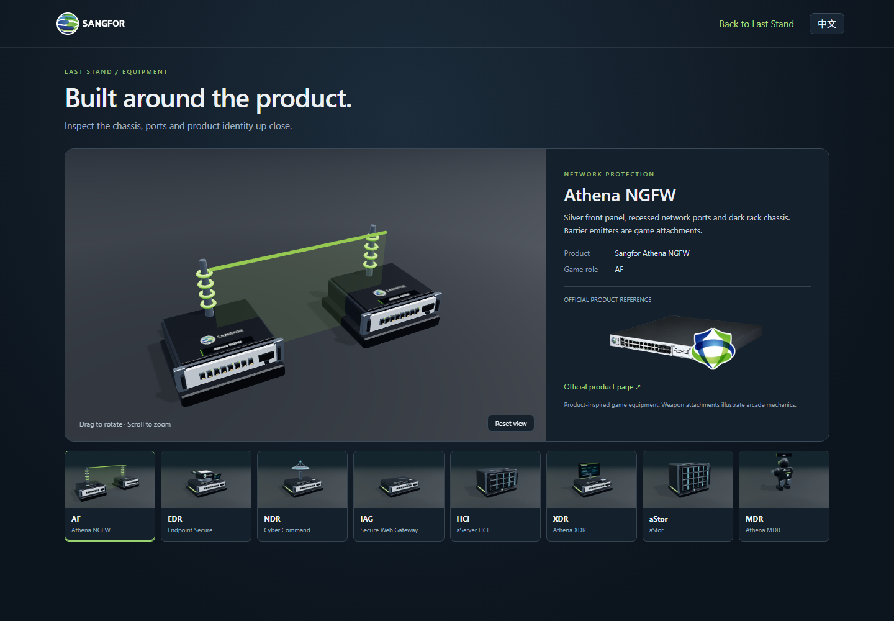
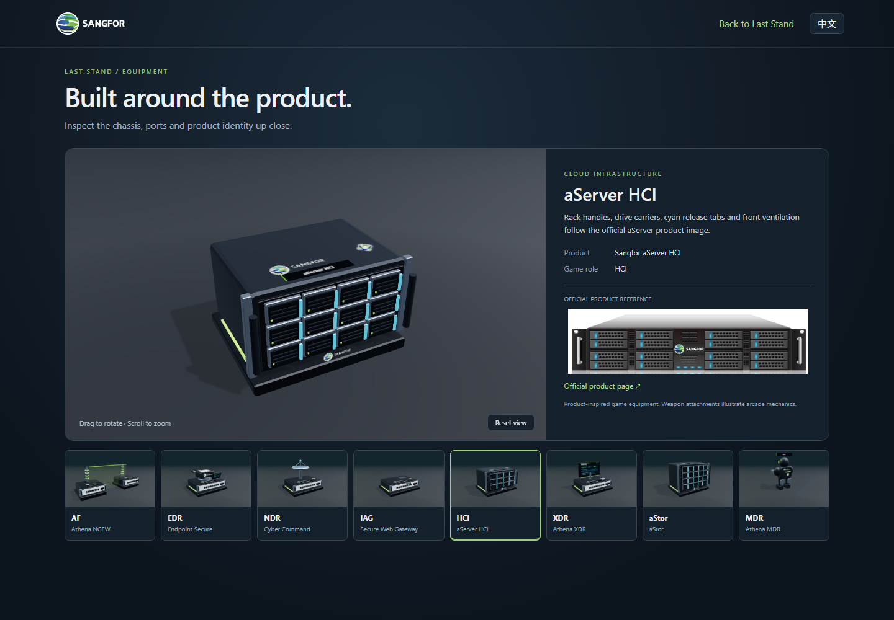
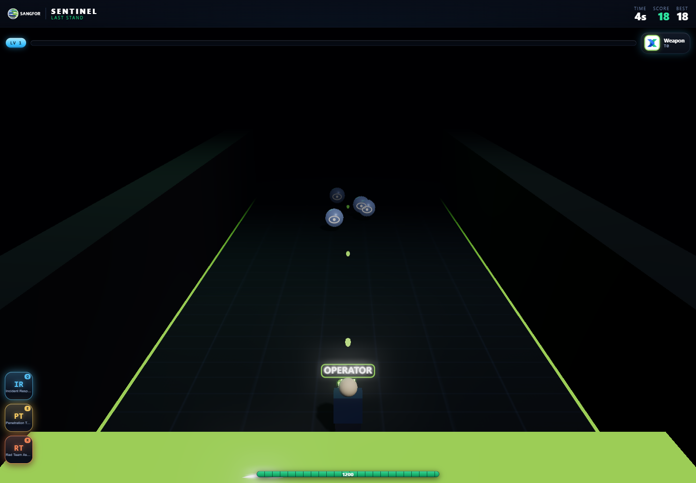
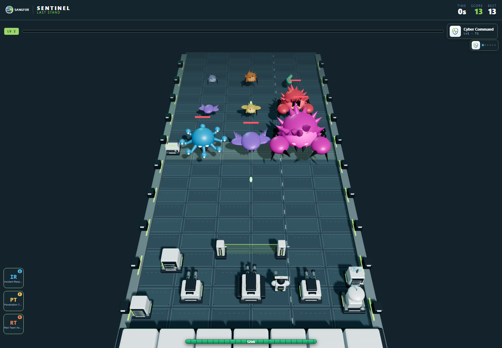
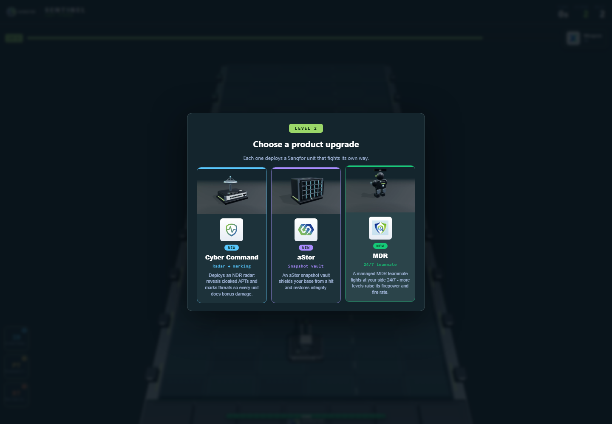
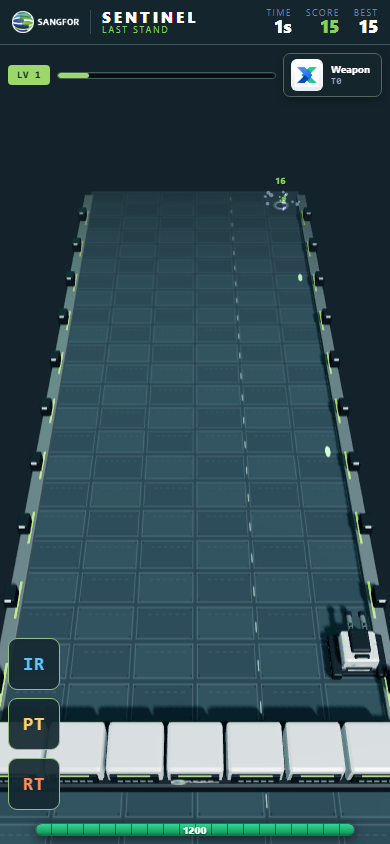

# Last Stand: Sangfor equipment art preview

## Version 2: product-referenced hardware

Current review tag: `stand-sangfor-visuals-v2`.

- [Play the updated preview](https://tru3tz0ne.github.io/sentinel-defend-the-tower/stand-sangfor.html?review=stand-sangfor-visuals-v2)
- [Inspect the actual models in 3D](https://tru3tz0ne.github.io/sentinel-defend-the-tower/stand-showroom.html)

The initial white miniature appliances did not convey recognizable Sangfor hardware. This revision starts with the official NGFW and HCI photographs rather than a generic white/green equipment palette.

Research sources, visited in a browser on 2026-11-01:

- [Athena NGFW product page](https://www.sangfor.com/cybersecurity/sangfor-athena-foundation/next-generation-firewall-ngfw) and its appliance photograph: dark low-profile case, silver front panel, dense network ports, vents and rack fittings.
- [HCI product page](https://www.sangfor.com/cloud-and-infrastructure/products/hci-hyper-converged-infrastructure) and its aServer photograph: graphite rack server, drive carriers, cyan release tabs, ventilation and rack handles.
- [Athena EPP product page](https://www.sangfor.com/cybersecurity/sangfor-athena-foundation/endpoint-protection-platform-epp): endpoint protection software, represented by an endpoint console and official product artwork on the game turret.
- [aStor product page](https://www.sangfor.com/cloud-and-infrastructure/products/astor-hybrid-flash-enterprise-data-storage-solution): storage positioning; the game storage chassis uses the reviewed rack-server design language, not a verified aStor appliance SKU.
- [NGFW NSF-7500A-I datasheet](https://www.sangfor.com/downloads/sangfor-athena-ngfw-datasheet-model-nsf7500a-i): public hardware form-factor and IO reference. The models are not dimensionally exact CAD reproductions.

### Changes

- Replaced the generic white cases with low graphite chassis, silver port panels, recessed contacts, link LEDs, rack ears, handle bars, vent openings and drive carriers.
- Added physical corporate wordmarks and product nameplates where the elevated game camera can see them. EDR has an endpoint console; XDR has a correlation display. These screens are authored game schematics, not screenshots of real deployments.
- Rebuilt the NGAF barrier around two recognizable network appliances with fictional emitter attachments. Replaced wireless-looking IAG antennas with wired ports and optical uplinks.
- Added studio reflections generated once at initialization, with no external HDR download and no new full-screen pass. Kept low reflection intensity on the battlefield floor and creatures so the hardware highlights do not wash out the playfield.
- Used simple box geometry for tiny contacts, vents and indicator lights. Beveled chassis silhouettes and merged material groups remain; fine detail does not require a separate mesh per screw or port.
- Added `stand-showroom.html`: one product at a time, drag/keyboard rotation, wheel/keyboard zoom, reset, EN/ZH, all eight products, and official NGFW/HCI reference photographs. It renders only on interaction/resize, has no animation loop, and is not instantiated inside the game.
- Regenerated the nine equipment images at higher resolution. Versioned script, stylesheet and thumbnail URLs avoid reusing the earlier preview from the browser cache.

The original `stand.html`, simulation, product rules and scoring remain unchanged. Tags v1 and v1.1 remain available as historical source snapshots.

### Review





The browser suite now also selects every showroom product, verifies stable geometry after a second complete selection cycle, checks that keyboard rotation changes the actual canvas image, switches language, checks phone overflow, and follows the return-to-game link. The existing game integration checks still cover all products and threats, shooting/XP/upgrade, abilities, pause, restart and phone movement. All 65 existing pure-rule checks pass. Full unrelated tower browser suites were not rerun locally.

V2 renderer counters from the paused inspection fixture: 168 draw calls, 62,142 triangles, 118 geometries and 22 textures. Geometry remains 118 after six warmed unit rebuilds. The isolated HCI showroom measures 10 draw calls and 2,526 triangles. Repeated complete showroom selection cycles do not increase geometry allocation. These counters describe the named fixtures; hardware FPS has not been measured.

See `assets/stand-sangfor/ASSETS.md` for the exact official image sources, excerpts and usage. The two reference photographs load only in the optional showroom. The rest of this document records the initial preview architecture and its historical measurements; v1 measurements below should not be treated as v2 performance results.

---

## Initial preview record

- Review tag: `stand-sangfor-visuals-v1.1`
- Branch: `feat/stand-sangfor-visuals`
- Baseline: `abb6797` on `main`
- Preview: [stand-sangfor.html](../stand-sangfor.html)
- Comparison: [stand.html](../stand.html)

## Result

The preview replaces the floating product badges, block-shaped operator and glowing threat spheres with original, lit 3D equipment and creatures. Existing official Sangfor logos remain attached to the equipment and visible in the HUD and product cards.

| Deployment | Preview appearance |
| --- | --- |
| Command avatar | Tracked mobile chassis, dual barrels, vents, corporate decal |
| EDR | White/graphite turret, paired metal barrels, green status strips |
| NGAF | Two appliance emitters and a restrained translucent barrier |
| MDR / temporary teams | Armored operatives, helmet visors, team accents |
| NDR | Antenna mast and radar dish |
| IAG | Low network appliance, ports, status LEDs and antennas |
| HCI | Three-bay compute appliance, placed separately from the command avatar |
| XDR | Relay appliance with a ring emitter |
| aStor | Five-bay storage vault |

All five normal threats and four bosses have modeled silhouettes: thorned mites, segmented worms, winged exfiltrators, cloaked mantas, armored ransomware claws, botnet tendrils and a larger siege creature. These are stylized arcade sculptures, not photorealistic scanned assets.

The deck has panel seams, mechanical borders and a segmented base. A steeper camera shows more of the firing lane. Neutral lighting exposes chassis details. Upgrade cards show renders of the equipment they deploy, alongside the official product mark. Preview-only styling simplifies the HUD and shortens the bilingual start instructions. Impact rings and screen flashes are reduced to preserve readability.

## Isolation and implementation

- `stand.html` keeps the original art. The opt-in `stand-sangfor.html` entry uses the same orchestrator, simulation, input, scoring, leaderboard and product codex.
- The v1.1 preview versions its orchestrator and engine URLs so cached scripts from an earlier visit to the original game cannot silently select the old renderer. The initial v1 tag remains an immutable source snapshot.
- `model.js` is unchanged. No balancing changes, new abilities, monetization or external services were introduced.
- `engine.js` accepts an optional art factory and delegates model creation/animation. Legacy camera, lights and bloom remain the defaults.
- `sangfor-art.js` builds native Three.js geometry, merges parts by material and caches model templates. Instances share geometry and own their materials. Removed units release instance materials; shared geometry is released when the game is destroyed.
- Unit rebuilding now removes children using the scene graph API instead of directly popping the children array.
- The preview uses a direct scene pass and disables preserved drawing buffers. No bloom render targets or additional runtime libraries are required.
- Equipment card images are small WebP renders of these same meshes. They load in menus/cards, not as a new game scene or additional WebGL renderer during play.
- Both interfaces remain available. All newly added explanatory strings have English and Chinese versions.

## Validation

Executed locally:

```text
node --test tools/engine.test.mjs tools/rush-logic.test.mjs tools/arcade-logic.test.mjs
65 passed

npm run render:stand-art
9 WebP previews rendered from the game meshes

npm run test:stand-art
Last Stand equipment preview checks passed
```

The browser integration check covers language switching; actual bullet damage leading to XP, an upgrade offer and a selected deployment; all eight product renderers; all nine threat renderers; pause; repeated unit rebuilds; support-team counts and cooldown rejection; restart; a 390 x 844 phone viewport; movement to the right boundary; and the legacy entry. It checks console errors, page errors and failed HTTP responses.

The inspection screenshot deliberately places all products and all threat types in one paused fixture. It is not evidence of a natural run, balance, or victory. The upgrade screenshot uses a one-hit target fixture followed by the normal firing/XP/choice path. Service-team screenshots also use a fixture.

Observed inspection cost: approximately 137 draws and 58,218 triangles. Geometry count stayed at 103 before/after six warmed unit rebuilds. These are renderer counters, not FPS claims or a benchmark on every GPU. The browser test enforces an inspection budget of fewer than 300 draws and 150,000 triangles. No full tower-game browser rerun is claimed for this isolated Last Stand visual change.

## Review images

Original battlefield:



Current v2 equipment and all threats, paused inspection fixture:



Current v2 equipment cards:



Phone movement boundary after restart:



## Asset provenance and rebuilding

New geometry, floor texture, labels and preview renders are original procedural artwork in this repository. Brand decals reuse the existing official artwork documented in `assets/brand/ASSETS.md`. Product marks retain their source image aspect ratios; they are not recolored or redrawn. The equipment is fictional arcade concept art and does not depict commercial appliance specifications.

Run `npm ci`, then `npm run render:stand-art` to regenerate the images, and `npm run test:stand-art` to validate the preview. `npm run serve` exposes both entries. The optional `HEADED=1` environment setting makes the standalone browser check visible.

The tag records a reviewable source version. GitHub Pages previews require publishing the files on the configured Pages branch; creating a tag alone does not deploy a website.

## Combined mode — the main entry (2026-10-31)

Follow-up, by owner decision: the sculpted equipment/creature models are now the
look of the main game, rendered under a cinematic stage rather than the neutral
product-showcase lighting. `stand.html` runs a new **combined** build
(`<body data-art="combined">`); `stand-sangfor.html` is unchanged and remains the
measured, bloom-less preview.

The engine's single `sculpted` flag was split so the showcase branch stays
byte-for-byte identical:

- `art` (models present) — unchanged; the Sangfor factory still supplies every
  operator/turret/radar/core/barrier/operative and creature silhouette.
- `showcase = sculpted && !atmosphere` — the preview's render style (steep camera,
  bright neutral lights, no bloom, no env map). Every preview-only value is now
  gated on `showcase`, so its draw/triangle/geometry counts are untouched.
- `atmosphere` (combined) — the cinematic stage: over-the-shoulder camera, warm
  key + cool rim + fill, a procedural equirectangular **env map** (lights the
  metal chassis and doubles as a graded sky backdrop, no external HDRI), tuned
  UnrealBloom, a corner vignette, and a slightly reflective deck. Combined keeps
  the default neon HUD and the product-mark upgrade cards (no preview hero/thumbs,
  so it loads no extra webp resources).

Validation: `npm run test:stand-art` green — showcase inspection stable at 137
draws / 58,218 triangles / 103 geometries (no change); the combined main entry
reports `diagnostics.art === "combined"` and loads with no page errors or failed
resources. `node --test tools/engine.test.mjs tools/arcade-logic.test.mjs
tools/rush-logic.test.mjs` green (65). Inspected desktop + 390x844 phone combat
frames on the software renderer: operator and creature silhouettes read clearly
against the graded backdrop; HUD and IR/PT/RT buttons unchanged. Boss frames and
hardware FPS were not measured on this software-WebGL workstation.

## EDR unit carries a branded Endpoint Secure appliance (2026-10-31)

Owner feedback on the combined look: each unit should more literally embody the
real Sangfor product. First pass on EDR — the turret now carries a recognizable
Endpoint Secure appliance on its mount: a white 1U chassis with a dark front
bezel, metal rack ears, a green status-LED row and top vent slits, with the EDR
product mark on its top face and an "Endpoint Secure" name plate across the back
(the face the combined camera sees). Added in `sangfor-art.js` `equipment('EDR')`
(shared by the showcase and combined entries); `edr.webp` and the lineup
`equipment-preview.webp` were regenerated with `npm run render:stand-art`.

Validation: `npm run test:stand-art` green; inspection fixture 174 draws / 63,726
triangles (within the <300 / <150k budget); combined entry still clean. The same
"carry the appliance" treatment can extend to the other units as a follow-up.
